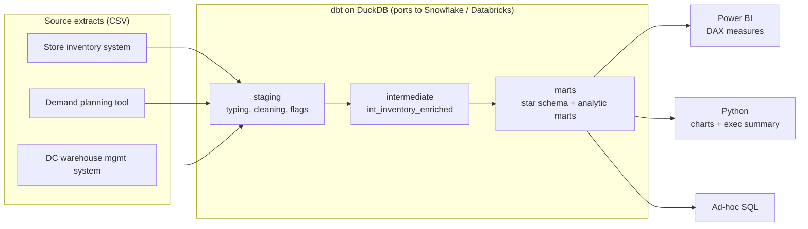

# Supply Chain Inventory Analytics

In-stock, forecast accuracy and stockout root-cause analytics for a 40-store retail pharmacy network, built as a tested dbt project.


> All data is **synthetic**, generated by a replenishment simulation (`scripts/generate_data.py`). It mirrors the kind of work I do in supply chain analytics without using any employer data.

## The business question

Planners see in-stock dip every winter and the default explanation is "demand was high." This project tests that explanation. It builds an inventory data model from three source systems, measures in-stock and forecast accuracy correctly, and **classifies every stockout by root cause** so the fix goes to the right team.

## Results

| KPI | Value |
|---|---|
| In-stock rate | **95.1%** |
| Lost sales | **$287K** (1.6% of demand) |
| Stockouts classified | **5,879** across 120,640 store x SKU x weeks |
| dbt data tests | **47 passing** |

### 1. The winter dip is really three separate problems

All three DCs dip in December, which looks like a demand story. But the Dallas DC falls much further, to **80.3%**, and the timing lines up with a drop in its fill rate. That points to a supply problem in Dallas on top of the seasonal one.

### 2. Root cause: most lost sales start with the forecast

Each stockout is assigned one primary cause in a fixed order: (1) the DC short-shipped enough to cause it, (2) the forecast was under this week **and** across the trailing 4 weeks, (3) safety stock was set too low, (4) none of these, so it was normal demand variability. Requiring the trailing 4-week bias separates a forecast that is consistently low from a single-week demand spike.

### 3. Cough & Cold is under-forecast every winter

Every other category runs slightly over-forecast. Cough & Cold goes from **+5% in the fall to -23% in Dec-Feb**. It is 16% of SKUs but **36% of forecast-driven stockouts**.

### 4. "What's our forecast accuracy?" depends on the level

The same forecast scores 65% at store x SKU x week and 93% at chain x category x week. Reporting accuracy without the level makes the number hard to interpret, so every accuracy figure in this project names its level.

### 5. The bottom 7 stores have one thing in common

Every one of the bottom 7 stores has safety stock set to 0 weeks. Fixing that is a configuration change, with no new forecasting work needed.

### Recommendations

1. **Add a winter seasonal index to the Cough & Cold forecast**, and track **bias** weekly, not only accuracy.
2. **Escalate Dallas DC fill rate** with the carrier, and alert when any DC is under 90% fill for 2 weeks in a row ([`sql/03_dc_fill_rate_alert.sql`](sql/03_dc_fill_rate_alert.sql)).
3. **Reset safety stock at 7 stores.** They average 89.1% in-stock vs 96.4% elsewhere.

The full numbers are in the auto-generated [executive summary](docs/EXECUTIVE_SUMMARY.md).

## Architecture



### Data model (marts)

| Model | Grain | Purpose |
|---|---|---|
| `fct_inventory_weekly` | store x SKU x week | Central fact table: positions, sales, lost sales, forecast, DC fill, weeks of supply |
| `dim_store`, `dim_product`, `dim_week`, `dim_distribution_center` | one row per entity | Star schema dimensions |
| `mart_in_stock_weekly` | week x DC x category | In-stock rate, rolling 4-week, week-over-week change |
| `mart_forecast_accuracy` | week x category | WAPE, accuracy, bias, rolling 4-week, worst-category rank |
| `mart_stockout_root_cause` | one row per stockout | Rule-based primary root cause |
| `mart_store_scorecard` | store | In-stock rank, quartile, gap to region average |

### Data quality built in

47 dbt tests run on every build, covering uniqueness, not-null, referential integrity and accepted values, plus three custom business-rule tests:

- `assert_inventory_balances`: begin + receipts - sales = end, for every row
- `assert_inventory_continuity`: this week's opening stock equals last week's closing stock
- `assert_sales_never_exceed_available`: no store sells stock it didn't have

Staging also handles real-world mess: mixed-case store names and about 0.2% of rows with missing forecasts, which are flagged and excluded from accuracy metrics instead of being counted as zero.

### Metric definitions

| Metric | Definition | Why this definition |
|---|---|---|
| In-stock % | 1 - (store x SKU weeks with lost sales / all store x SKU weeks) | Measures it the way a customer experiences it |
| WAPE | sum(\|forecast - demand\|) / sum(demand) | Volume-weighted, so slow movers with tiny denominators don't swamp it the way MAPE does |
| Bias | sum(forecast - demand) / sum(demand) | Accuracy hides direction. Bias shows systematic under- or over-forecasting |
| Demand | sales + lost sales (unconstrained) | Measuring against sales alone makes the forecast look better during stockouts |

## SQL showcase

[`sql/`](sql/) has stand-alone analytical queries against the marts:

| Query | Technique |
|---|---|
| [`01_top_lost_sales_skus.sql`](sql/01_top_lost_sales_skus.sql) | Top-N per group with `RANK()` + `QUALIFY` |
| [`02_consecutive_stockout_streaks.sql`](sql/02_consecutive_stockout_streaks.sql) | Gaps-and-islands to find chronic 3+ week stockouts |
| [`03_dc_fill_rate_alert.sql`](sql/03_dc_fill_rate_alert.sql) | `LAG()` alerting logic for consecutive misses |
| [`04_abc_xyz_segmentation.sql`](sql/04_abc_xyz_segmentation.sql) | Running-total Pareto (ABC) x coefficient of variation (XYZ) |

## Power BI

[`powerbi/measures.dax`](powerbi/measures.dax) holds the DAX measure layer for the report on top of the star schema: in-stock with prior-week and rolling 4-week time intelligence, target status, WAPE, bias, DC fill rate, and `RANKX` store ranking.

## Run it yourself

```bash
git clone https://github.com/abiagrawal33-prog/supply-chain-inventory-analytics.git
cd supply-chain-inventory-analytics
pip install -r requirements.txt
make all        # generate data -> dbt build (models + tests) -> charts + summary
make docs       # optional: browse dbt lineage graph and column docs
```

It runs in about 10 seconds on a laptop with no database server needed. To run on Snowflake or Databricks, change the target in `dbt/profiles.yml`. The models use portable SQL, and the one DuckDB-specific function sits behind a macro (`proper_case`) that falls back to `initcap()`.

## Project structure

```
├── scripts/
│   ├── generate_data.py      # replenishment simulation -> raw CSV extracts
│   └── analyze.py            # charts + executive summary from marts
├── dbt/
│   ├── models/staging/       # 5 views: typing, cleaning, flags
│   ├── models/intermediate/  # enriched store x SKU x week
│   ├── models/marts/         # star schema + 4 analytic marts
│   ├── tests/                # custom business-rule tests
│   └── macros/               # safe_divide, proper_case, schema naming
├── sql/                      # ad-hoc analytical queries
├── powerbi/measures.dax      # DAX measure layer
└── docs/                     # charts + executive summary
```
